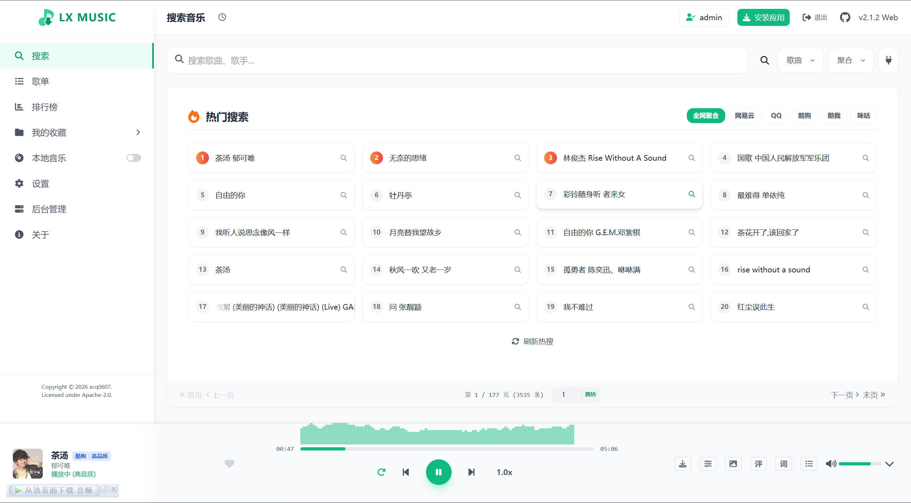
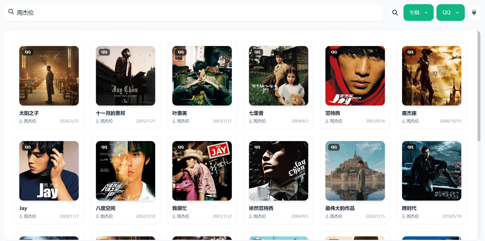
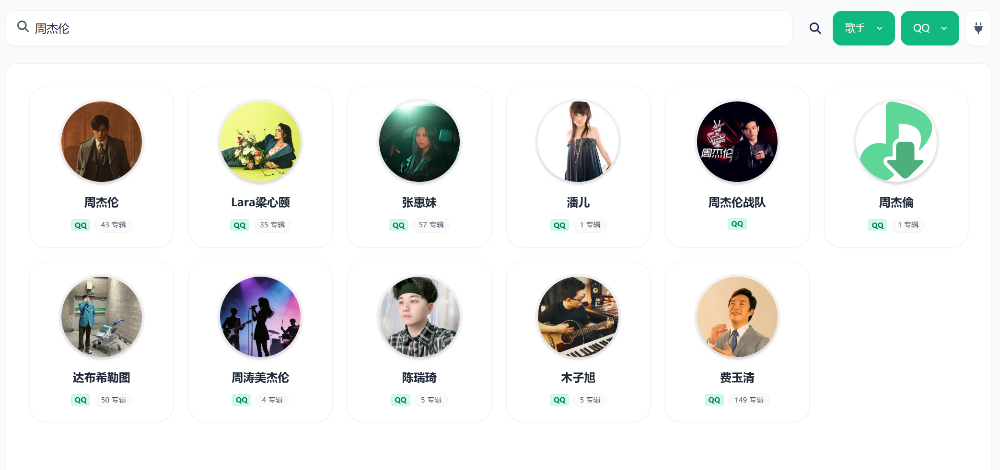
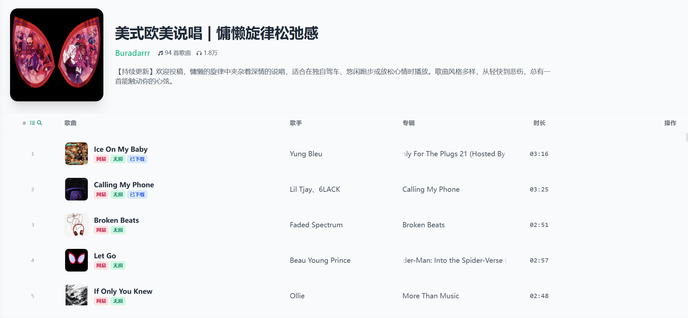
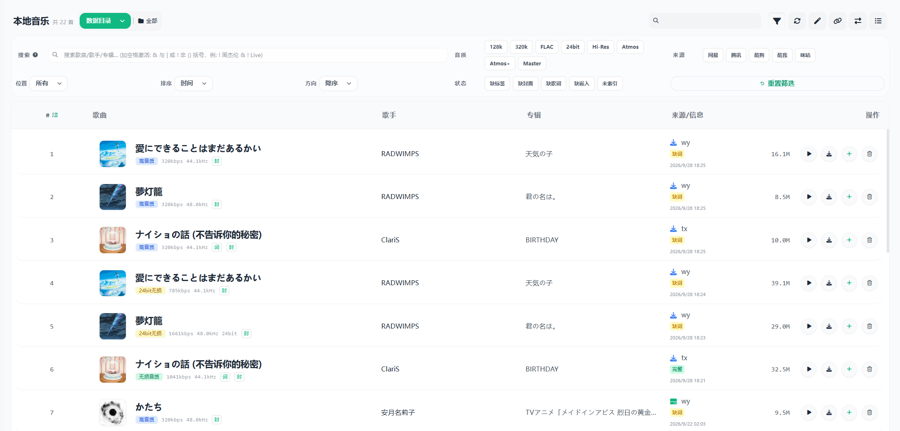
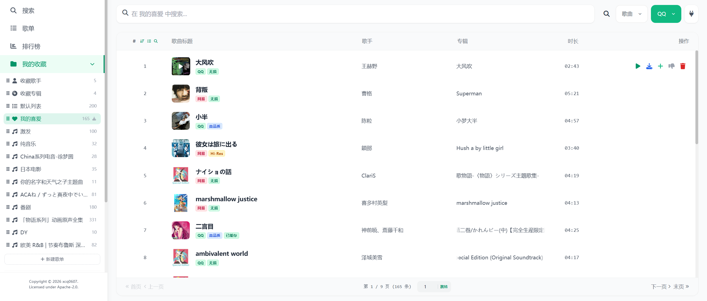
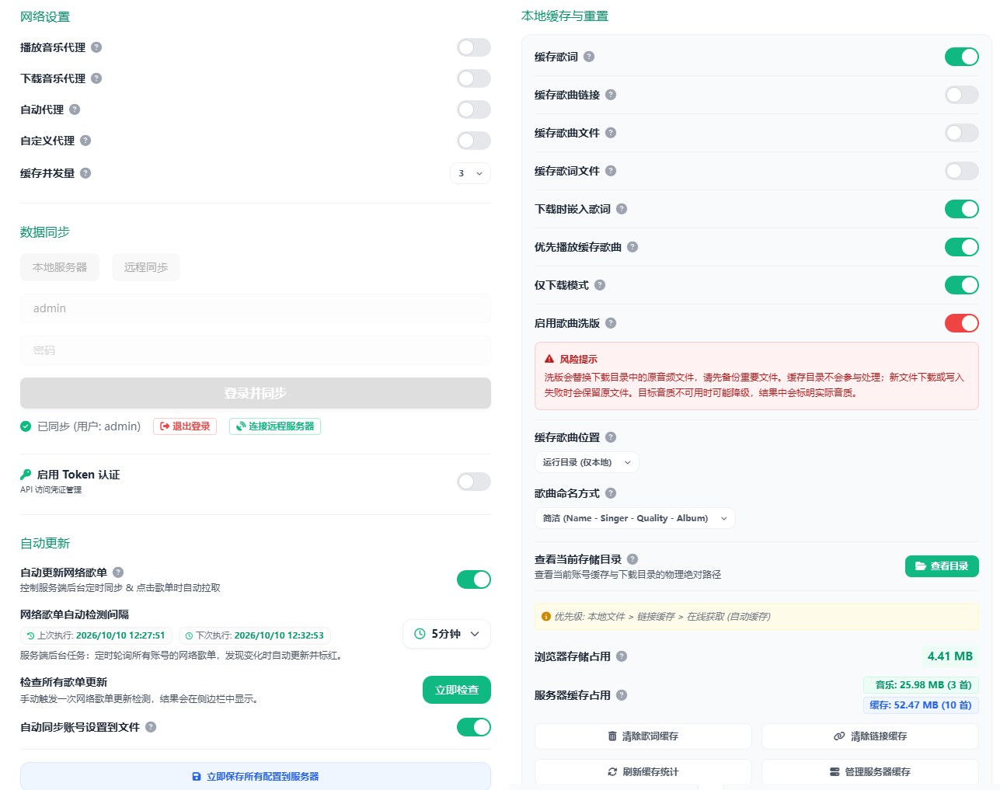

# LX Music Sync Server (Enhanced Edition)


<div align="center">
  <p>
    
    
    
    <br>
    <br>
    <a href="https://github.com/XCQ0607/lxserver/stargazers"></a>
    <a href="https://github.com/XCQ0607/lxserver/network/members"></a>
    <a href="https://github.com/XCQ0607/lxserver/issues"></a>
    <a href="https://github.com/XCQ0607/lxserver/commits/main"></a>
    
    <a href="https://github.com/XCQ0607/lxserver/releases"></a>
  </p>
  <p>
    <a href="https://www.star-history.com/xcq0607/lxserver">
      <picture>
        <source media="(prefers-color-scheme: dark)" srcset="https://api.star-history.com/badge?repo=XCQ0607/lxserver&type=trending&theme=dark" />
        <source media="(prefers-color-scheme: light)" srcset="https://api.star-history.com/badge?repo=XCQ0607/lxserver&type=trending" />
        
      </picture>
    </a>
  </p>
</div>

[帮助文档 Documentation](https://xcq0607.github.io/lxserver/) | [同步服务器 SyncServer](md/lxserver.md) | [更新日志 Changelog](changelog.md) | [English](README_EN.md)


---

LX Music Sync Server 是一个可以自行部署的音乐同步服务。它在 [LX Music 同步服务端](https://github.com/lyswhut/lx-music-sync-server) 的基础上加入了 Web 播放器、本地音乐管理、服务端下载、Subsonic 接口和管理后台。

同一套服务可以供浏览器、LX Music 桌面端/移动端以及支持 Subsonic 的客户端使用。LX 客户端同步的是歌单等数据；服务器上的音频文件由本地音乐库管理，不会随歌单同步自动传到每台设备。

## 文档导航

- [部署与首次使用](#部署与首次使用)
- [连接客户端](#连接客户端)
- [播放器与音乐管理](#播放器与音乐管理)
- [账号与权限](#账号与权限)
- [数据目录与备份](#数据目录与备份)
- [配置方式](#配置方式)
- [常见问题](#常见问题)
- [开发与接口](#开发与接口)

完整文档见 [文档站](https://xcq0607.github.io/lxserver/)，接口说明见 [API 参考](docs/api/reference.md) 和 [路由索引](docs/api/routes.md)。英文介绍见 [README_EN.md](README_EN.md)。

## 部署与首次使用

### 选择运行方式

| 方式 | 适用情况 | 需要准备 |
| --- | --- | --- |
| Docker / Docker Compose | NAS、服务器、长期运行 | Docker，保存配置和音乐的宿主机目录 |
| Node.js 源码运行 | 本地开发、自行修改或编译 | Node.js 22.13.0 或更高版本、npm、Git |
| Release 服务端压缩包 | 使用已编译的服务端 | Node.js 22.13.0 或更高版本，包含编译产物的发行包 |
| 桌面客户端 | 在桌面窗口中管理与使用服务 | 与操作系统、CPU 架构匹配的安装包 |
| PM2 托管 | 已编译的 Node.js 服务长期运行 | 单独安装 PM2，先完成构建 |

默认主端口是 `9527`。启动后，播放器位于 `/`，管理后台位于 `/admin`，Subsonic 路径为 `/rest`。

### Docker Compose

在准备保存数据的目录中创建 `compose.yaml`：

```yaml
services:
  lx-sync-server:
    image: xcq0607/lxserver:latest
    container_name: lx-sync-server
    restart: unless-stopped
    ports:
      - "9527:9527"
    volumes:
      - ./data:/server/data
      - ./cache:/server/cache
      - ./music:/server/music
      # 使用已有音乐目录时再添加挂载，例如：
      # - /mnt/nas/music:/library:ro
    environment:
      NODE_ENV: production
      ADMIN_PASSWORD: "replace-with-your-admin-password"
      ENABLE_WEBPLAYER_AUTH: "true"
      WEBPLAYER_PASSWORD: "replace-with-your-player-password"
      # 创建同步用户，也可以启动后在后台添加：
      # LX_USER_user1: "replace-with-your-user-password"
```

执行：

```bash
docker compose up -d
docker compose logs -f --tail=100
```

也可以将镜像名换成 `ghcr.io/xcq0607/lxserver:latest`。固定版本部署时，把 `latest` 换成镜像仓库实际存在的版本标签。

镜像默认将日志写入 `/server/data/logs`，上述 `data` 挂载已包含日志。如需单独保存，增加 `./logs:/server/logs` 挂载，并同时设置 `LOG_PATH: /server/logs`。只挂载 `/server/logs` 不会改变默认日志位置。

`cache` 和 `music` 挂载用于程序根目录存储模式；选择数据目录存储后，相应文件位于 `/server/data` 下。保留这三个挂载，可以在切换存储模式和更新容器时继续使用原文件。

### Docker Run

以下为 Bash 示例，路径相对于当前目录：

```bash
docker run -d \
  --name lx-sync-server \
  --restart unless-stopped \
  -p 9527:9527 \
  -v "$(pwd)/data:/server/data" \
  -v "$(pwd)/cache:/server/cache" \
  -v "$(pwd)/music:/server/music" \
  -e ADMIN_PASSWORD="replace-with-your-admin-password" \
  -e ENABLE_WEBPLAYER_AUTH=true \
  -e WEBPLAYER_PASSWORD="replace-with-your-player-password" \
  xcq0607/lxserver:latest
```

Windows PowerShell 用户可以使用上面的 Compose 文件，避免多行命令和路径语法的差异。

### 从源码运行

```bash
git clone https://github.com/XCQ0607/lxserver.git
cd lxserver
npm ci
npm run build
npm start
```

构建会生成服务端 JavaScript、播放器样式和文件管理器前端资源，并检查音频指纹工具。安装和首次构建需要访问依赖仓库及相关二进制下载地址。

本地开发使用 `npm run dev`。修改 TypeScript 源码后，生产运行方式需要重新执行 `npm run build`；`npm start` 加载的是 `server/` 中的编译结果。

### Release 与桌面客户端

从 [GitHub Releases](https://github.com/XCQ0607/lxserver/releases) 下载对应文件。桌面版选择匹配系统与架构的安装包，具体提供哪些构建以该次发布的附件为准。

服务端压缩包需要包含 `server/`、`public/`、`index.js` 和 `package.json` 等运行文件。解压后安装生产依赖并启动：

```bash
npm install --omit=dev
node index.js
```

GitHub 自动生成的 Source code 压缩包是源码，不能当作已编译的服务端包使用；使用源码包时按前面的源码步骤构建。

`node index.js` 直接运行编译产物，不执行 npm 生命周期脚本；`npm start` 还会执行音频指纹工具检查和构建信息刷新。使用 npm 启动时需保留发行包中的 `scripts/`。桌面版使用独立的存储设置，端口被占用时会尝试其他端口，以应用实际显示的地址为准。

### PM2 托管与自行构建镜像

先完成依赖安装和构建，再在项目目录执行：

```bash
npm install -g pm2
npm run prd
pm2 status
pm2 logs lx-music-sync-server
pm2 save
```

`npm run prd` 调用 `pm2 start ecosystem.config.js --env production`，不会自动构建。PM2 不在项目依赖内，需要单独安装；`pm2 save` 保存进程列表，系统开机自启还需按部署系统配置。

如需使用自己修改的 Docker 镜像：

```bash
docker build -t lxserver:local .
```

把 Compose 中的镜像改为 `lxserver:local` 后启动。桌面包构建命令为 `npm run electron:dist`，原生模块与打包环境要求取决于目标系统；它属于开发构建流程，不是普通服务端的启动命令。

### 第一次启动后

1. 打开 `http://服务器IP:9527/admin`，使用设置的管理员密码登录。未配置时，默认密码是 `123456`。
2. 在“用户管理”中创建个人账号，设置用户名和同步密码。
3. 打开 `http://服务器IP:9527/`。若启用了播放器访问认证，先输入播放器访问密码，再按需登录个人账号。
4. 需要在线播放时，在自定义源管理中导入可用的音源脚本并启用。
5. 需要管理本地歌曲时，检查存储位置、目录挂载和账号权限，再扫描音乐目录。

管理员密码、播放器访问密码、个人账号密码用途不同，详见“账号与权限”。

## 连接客户端

### 浏览器

| 入口 | 默认地址 | 用途 |
| --- | --- | --- |
| Web 播放器 | `http://服务器IP:9527/` | 搜索、播放、歌单和本地音乐管理 |
| 管理后台 | `http://服务器IP:9527/admin` | 用户、系统配置、备份、日志和文件管理 |

可以通过 `PLAYER_PATH` 和 `ADMIN_PATH` 改变路径。例如播放器设为 `/music` 后，访问 `http://服务器IP:9527/music`。两个路径不能相同，也不能占用 `/api` 路径；根路径使用 `/`。

手机和电脑使用相同地址访问。音频自动播放、锁屏播放和媒体按键行为还受浏览器及系统权限影响。

### LX Music 桌面端与移动端

在 LX Music 的“设置 → 同步设置”中选择自定义服务器。

| 模式 | 连接地址示例 | 密码 | 要求 |
| --- | --- | --- | --- |
| 用户路径模式，默认开启 | `http://192.168.1.100:9527/user1` | user1 的同步密码 | `USER_ENABLE_PATH=true`，按用户名区分用户，允许不同用户密码相同 |
| 根路径模式，默认关闭 | `http://192.168.1.100:9527` | 对应用户的同步密码 | `USER_ENABLE_ROOT=true`，用户密码必须唯一 |

这里填写个人账号的同步密码。连接同步服务不使用 `/admin`、`/rest` 或播放器访问密码。

首次同步时留意客户端给出的合并、覆盖方向。已有歌单建议先备份，再决定哪一端的数据作为基准。同步协议和配置细节见 [同步服务说明](md/lxserver.md)。

### Subsonic 客户端

支持使用音流、Feishin、Symfonium 等客户端访问已实现的 Subsonic/OpenSubsonic 接口。各客户端支持的功能不同，接口范围和已知限制见 [Subsonic 状态](docs/subsonic-status.md)。

默认连接信息：

| 项目 | 填写内容 |
| --- | --- |
| 服务地址 | `http://服务器IP:9527/rest` |
| 用户名 | 后台创建的个人账号 |
| 密码 | 该账号的同步密码 |

部分客户端会自动拼接 `/rest`；这类客户端按其提示填写主机地址，避免最终请求变成 `/rest/rest`。

默认与主服务共用端口。需要独立端口时，在后台开启独立监听，或在配置中设置 `subsonic.standalone=true`，并设置 `subsonic.port`。端口默认值为 `4050`，**只设置 `SUBSONIC_PORT` 不会开启独立监听**。Docker 还需要额外映射对应端口；协议路径由 `subsonic.path` 决定。

在线搜索由 `subsonic.onlineSearch` 和 `subsonic.onlineSearchMode` 控制：

| 模式 | 行为 |
| --- | --- |
| `fallback` | 本地搜索不足时补充在线结果 |
| `merge` | 合并本地与在线结果 |
| `local_only` | 仅搜索本地内容 |

搜索词还支持 `wy:`、`tx:`、`kw:`、`kg:`、`mg:` 指定平台，以及 `online:`、`local:` 前缀指定搜索范围。在线播放仍依赖可用的自定义音源。

Subsonic 本地曲库按当前账号的持久化存储设置读取音乐和缓存，并加入该账号已启用的自定义目录。网页中临时切换浏览目录，不会改变 Subsonic 的曲库范围。

默认返回只读的“本地歌曲”歌单；自定义目录可以单独显示。纯本地歌单保存在服务端，不进入 LX 官方客户端同步；混合歌单中的在线歌曲和本地成员分别保存。详情见 [Subsonic 本地音乐库](docs/subsonic-local-library.md)。

<p align="center">
  
  
</p>

## 播放器与音乐管理

### 播放与界面

播放器提供播放队列、音质切换、倍速、睡眠定时、全屏歌词和主题设置。桌面和手机使用响应式布局；可以按自己的使用习惯选择主题、播放器背景和歌词展示方式。

页面会显示版本与构建指纹，例如 `v2.1.4 · build 123abcd`。版本来自 `package.json`，指纹由构建或启动脚本刷新，排查同一版本下的自定义改动时可以一并提供。

<p align="center"></p>
<p align="center"></p>

### 搜索、歌手与专辑

在线搜索使用酷我（`kw`）、酷狗（`kg`）、QQ 音乐（`tx`）、网易云（`wy`）和咪咕（`mg`）等平台数据。可以按单个平台搜索，也可以在支持的搜索类型中使用聚合模式。

单源歌曲搜索由服务端连续获取结果，前端在收到的列表中分页。平台可能限制结果深度，服务端也设有页数和耗时预算，因此页面显示的结果数不一定等于平台自报总数。歌手、专辑和歌单等搜索类型的支持情况随平台而异。

搜索到歌曲信息与取得可播放链接是两个步骤：前者来自音乐平台检索，后者由自定义音源解析。因此，能搜到歌曲但无法播放时，应先检查自定义源、音质和网络请求，而不是反复清空搜索结果。

<p align="center"></p>
<p align="center">
  
  
</p>

### 歌单、收藏与播放队列

播放器支持个人歌单、收藏歌手与专辑、平台歌单、排行榜，以及播放队列调整。个人数据归属于登录账号；公开收藏是否显示和允许访问，由后台公共权限控制。

平台歌单与用户自己的同步歌单用途不同。对个人歌单的增删会影响同步数据；浏览平台榜单不会把整个榜单自动写入个人歌单。

<p align="center">
  
  
</p>
<p align="center">
  
  
</p>

### 本地音乐与下载

本地音乐页用于查看服务器上的音频文件，包括下载目录、缓存目录和已授权的自定义音乐目录。可查看音频规格、封面、歌词和关联状态，使用 `&`、`|`、`!` 组合条件筛选，并执行批量操作。

| 操作 | 文件保存位置 / 影响 |
| --- | --- |
| 浏览器下载 | 由浏览器保存到访问设备，受浏览器下载权限控制 |
| 服务端下载或缓存 | 保存到服务器目录，占用服务器磁盘和网络资源 |
| 关联在线歌曲、更新元数据 | 将本地文件与平台歌曲信息关联，相关操作可能改写音频标签 |
| 嵌入歌词 | 写入音频文件中的歌词标签，具体支持取决于格式 |
| 洗版 | 解析并下载其他可用音质来替换已关联文件，自定义目录操作需要额外权限；与播放时的转码是两套机制 |

服务端下载使用后台队列，支持查看进度、调整并发、恢复和移除任务。关闭网页与停止服务端任务不是同一件事；需要停止下载时应在任务界面操作。

自动匹配针对选中的未关联文件识别、检索并关联平台歌曲，保留逐曲结果，可查看进度或取消。默认并发为 2，可设置 1–4；服务重启后未完成任务标记为中断，需要重新选择剩余歌曲。相同歌名、现场版和重录版仍可能匹配错误，批量改写前先抽查结果。

洗版需要歌曲已有可用的平台来源与 ID。已是目标音质、目标文件已存在、没有获得符合方向的替换音质时会跳过；不能把它理解为把任意低码率文件转换成真正的无损音频。

已有 NAS 音乐目录可以挂载后分配给用户。例如容器挂载 `/mnt/nas/music:/library:ro` 后，后台填写 `/library`，不是宿主机路径 `/mnt/nas/music`。只读挂载适合浏览播放；需要写入标签、删除或洗版时，还要同时满足容器文件权限和账号操作权限。

<p align="center"></p>
<p align="center"></p>

### 自定义源、主题与歌词卡片

自定义源脚本负责解析在线歌曲的音频链接。导入后检查源是否启用、是否支持目标平台和音质；不同脚本的可用性、返回速度及链接有效期可能不同。

播放器还提供主题、深浅色模式、背景选择和歌词分享卡片。生成卡片时可以选择适合分享平台的比例，再保存图片。

<p align="center">
  
  
</p>
<p align="center">
  
  
</p>

### 音效、投屏与后台任务

播放器有均衡器和变调控制，处理能力取决于浏览器音频接口及资源访问条件。如果启用音效后需要恢复原生播放或 AirPlay，可使用音效面板中的恢复入口。

Chromecast 支持具备 Cast 能力的桌面/Android Chromium 浏览器，需要安全上下文，通常为 HTTPS。接收设备还必须能访问服务器和媒体资源；浏览器中的 `blob:` 或本地文件链接不能直接交给接收设备读取。投屏时由接收端播放，浏览器音效和倍速不会应用到接收端；iOS 保留原生 AirPlay 路径。

网络歌单定时检查、同步下载和普通歌单同步分别配置。可以在任务界面检查上次执行、下次执行和结果；启用歌单同步不会自动开启音频下载。更多操作步骤见 [播放器指南](docs/guide/web-player.md)。

## 账号与权限

### 三种密码的用途

| 凭据 | 配置位置 | 用途 |
| --- | --- | --- |
| 管理员密码 | `admin.password` / `ADMIN_PASSWORD` | 管理后台、系统配置和管理员操作 |
| 播放器访问密码 | `player.password` / `WEBPLAYER_PASSWORD` | 开启 `player.enableAuth` 后进入 Web 播放器 |
| 用户同步密码 | 后台用户管理或 `LX_USER_<用户名>` | 个人账号登录、LX Music 同步及 Subsonic 登录 |

播放器访问密码控制进入播放器，不会自动建立个人账号或授予目录写入权限。

### 公共访问与个人权限

`user.enablePublicRestriction` 控制公共权限限制，默认开启。具体能力还由对应开关决定，不能仅凭“已经登录”判断某个操作一定可用。

| 配置项 | 控制内容 |
| --- | --- |
| `user.enablePublicNonAdminLocalMusic` | 非管理员访问公共本地音乐 |
| `user.enablePublicNonAdminBrowserDownload` | 非管理员浏览器下载 |
| `user.enablePublicNonAdminServerCache` | 非管理员向服务器缓存或写入歌曲 |
| `user.enablePublicFavorites`、`user.enablePublicNonAdminAccess` | 公开收藏的展示与访问 |
| `user.enableLoginCacheRestriction` | 登录用户缓存设置限制 |
| `user.enableCacheSizeLimit`、`user.cacheSizeLimit` | 缓存容量限制 |

自定义音乐目录还需要给具体用户设置 `enableCustomMusicDir` 和 `customMusicDir`。`allowOperateCustomMusicDir` 控制删除、洗版等操作，`allowWriteCustomMusicDir` 控制关联、元数据和歌词写入。挂载目录可读不代表自动允许修改文件。

需要脚本访问时，可在个人 Token 管理中创建持久化 API Token，设置名称、有效期并按需禁用或删除。用户 Token 不等于管理员密码；每个脚本单独分配 Token，后续可以单独撤销。接口鉴权方式见 [API 参考](docs/api/reference.md)。

## 数据目录与备份

### 目录分别保存什么

| 位置 | 内容 | 迁移时的处理 |
| --- | --- | --- |
| `data/` 或 `DATA_PATH` | 配置、账号、歌单、用户状态及运行数据 | 整体保存，作为迁移的基础 |
| `data/config.js` | 当前服务配置，除非显式设置 `CONFIG_PATH` | 与账号和其他数据一起备份 |
| 程序根目录的 `cache/`、`music/` | 根目录存储模式下的音频及索引 | 使用该模式时单独保留 |
| 数据目录下的 `cache/`、`music/` | 数据目录存储模式下的音频及索引 | 随数据目录一起保留 |
| 自定义音乐目录 | 用户已有的外部音乐文件 | 单独备份，并保留容器挂载关系 |
| 日志目录 | 启动、请求和后台任务日志 | 源码运行默认 `logs/`；Docker 默认 `data/logs/` |

音频目录内还会按账号隔离文件，实际路径可在界面或目录接口中查看。网页临时浏览其他位置不会自动迁移文件，也不会更改账号持久化的存储选择。

Subsonic 用户目录中的 `subsonic-local-registry.json` 和 `subsonic-local-state.json` 保存本地歌曲身份、收藏及歌单关系，迁移时应保留，不能当作可随意删除的临时缓存。

### 快照、配置备份与云端备份

歌单快照用于恢复歌单数据，配置备份用于恢复 `config.js`，它们都不能代替音频文件备份。

配置备份默认开启，保留 7 天；默认位置为数据目录的 `backups/`。可以用 `CONFIG_BACKUP_DIR` 和 `SNAPSHOT_BACKUP_PATH` 自定义配置备份、歌单快照的存储位置。

在「系统设置 → 云端备份范围」中，可分别选择 WebDAV 和 OpenList 备份的数据类型。两端默认都选中以下五类，但仍需单独启用对应服务并配置连接信息；同时启用会保存两份副本，不会在两个云端之间同步。

| 类型 | 备份内容 |
| --- | --- |
| `music` 歌曲文件 | 仅数据目录内的 `music/`，包含歌曲、歌词、封面和音乐索引 |
| `userFiles` 用户文件 | 源脚本、源相关状态及上传文件 |
| `snapshots` 快照文件 | 歌单、屏蔽列表快照及索引，包括配置的外部快照目录 |
| `userData` 用户数据 | 用户目录内其余持久化数据，如歌单、偏好及 Subsonic 本地关系数据 |
| `system` 系统数据 | 当前生效的配置文件及数据目录根部的账号、服务信息等 JSON 文件 |

这些设置属于系统配置，保存在当前生效的 `config.js`，没有对应环境变量：

```js
'backup.webdav.types': ['music', 'userFiles', 'snapshots', 'userData', 'system'],
'backup.openlist.types': ['music', 'userFiles', 'snapshots', 'userData', 'system'],
'backup.webdav.mirrorDeletes': false,
'backup.webdav.restoreOnStartup': false,
```

类型数组为空表示该端不备份任何数据类型。普通数据备份始终排除缓存、日志、临时文件、运行数据库和本地备份包；程序根目录的音乐和自定义外部音乐库需要另行备份。OpenList 的「永久播放缓存」单独配置，勾选歌曲文件不会自动开启缓存上传或删除本地歌曲。

WebDAV 增量文件与 ZIP 备份采用相同范围，默认分别每 60 分钟、24 小时执行；OpenList 数据备份保存在其根目录的 `_data/` 下，默认每 60 分钟检查。普通备份保留本地文件。WebDAV 默认也保留云端已有文件，只有显式开启 `backup.webdav.mirrorDeletes` 才会向增量目录传播本地删除，历史 ZIP 不受影响。

WebDAV 默认不在启动时恢复，需显式开启 `backup.webdav.restoreOnStartup`。手动恢复按该端当前勾选范围下载，覆盖本地同名文件并保留本地独有文件，不会反向上传。恢复不是整个目录的原子替换，完成后应重启服务，使配置、账号、歌单和音乐索引完整重新加载。部署新实例前确认云端目录和备份范围，具体步骤见 [备份与恢复](docs/guide/backup-recovery.md)。

### 更新与迁移

更新前保存数据目录、实际使用的音频目录以及外部配置文件。Docker Compose 部署可以执行：

```bash
docker compose pull
docker compose up -d
docker compose logs --tail=100
```

源码部署更新后重新安装依赖、构建并重启；不要只拉取源码就继续使用旧的 `server/`。迁移完成后检查账号登录、歌单数量、本地目录扫描和一首歌曲的实际播放。

## 配置方式

系统默认使用 `data/config.js`；`DATA_PATH` 改变数据目录，`CONFIG_PATH` 指定独立配置文件。首次启动时，若目标配置文件不存在，会尝试从程序根目录的旧配置初始化。

普通启动按默认值、配置文件、环境变量的顺序合并配置。显式启用 WebDAV 启动恢复时，恢复过程还会重新加载远端配置和账号数据；手动恢复后需要重启服务。当前生效值和配置路径可在管理后台查看。

环境变量在进程启动时读取。修改 Compose 中的环境变量后需要重建容器；后台配置是否即时生效取决于具体选项，监听端口和路径调整后应按提示重新连接或重启。

### 环境变量参考

以下列出常用环境变量。默认值以代码默认配置为基准；仓库自带配置、历史数据和后台保存值可能覆盖它们。`DATA_PATH`、`LOG_PATH` 在 Docker 镜像中另有默认设置，见部署章节。

| 环境变量                                     | 对应配置项                                   | 说明                                                                                               | 默认值               |
| -------------------------------------------- | -------------------------------------------- | -------------------------------------------------------------------------------------------------- | -------------------- |
| `PORT`                                     | `port`                                     | 服务端口                                                                                           | `9527`             |
| `BIND_IP` | `bindIP` | 服务监听地址 | `0.0.0.0` |
| `ADMIN_PATH`                               | `admin.path`                               | 后台管理界面访问路径                                                                               | `/admin`           |
| `PLAYER_PATH`                              | `player.path`                              | Web 播放器访问路径 (默认为根路径 `/`)                                                            | `/`                |
| `ADMIN_PASSWORD`                           | `admin.password`                           | 管理员密码（用于登录控制台和音乐播放器管理员登录）                                                 | `123456`           |
| `SERVER_NAME`                              | `serverName`                               | 同步服务名称（客户端连接展示名称及管理后台标题）                                                   | `LX Sync Server`   |
| `PLAYER_NAME`                              | `player.name`                              | Web 播放器名称（播放器网页标题及登录卡片标题）                                                     | `LX Music Web`     |
| `ENABLE_DEBUG`                             | `debug.enabled`                            | 是否启用 DEBUG 模式 (开启后输出详细调试日志与音源内部日志，默认关闭)                               | `false`            |
| `MAX_SNAPSHOT_NUM`                         | `maxSnapshotNum`                           | 保留的最大快照数量                                                                                 | `10`               |
| `CONFIG_PATH`                              | -                                            | 指定外部配置文件的绝对路径 (默认使用 `data/config.js`)                                           | -                    |
| `DATA_PATH`                                | -                                            | 指定数据存储目录的绝对路径                                                                         | `./data`           |
| `LOG_PATH`                                 | -                                            | 指定日志输出目录的绝对路径                                                                         | `./logs`           |
| `PROXY_HEADER` | `proxy.header` | 代理转发的原始 IP 头 | `x-real-ip` |
| `USER_ENABLE_ROOT`                         | `user.enableRoot`                          | 启用根路径 (开启后连接URL即为 `ip:port`，不允许不同用户密码相同)                                 | `false`            |
| `USER_ENABLE_PATH`                         | `user.enablePath`                          | 启用用户路径 (开启后连接URL需为 `ip:port/用户名`，允许密码相同)                                  | `true`             |
| `WEBDAV_ENABLE`                            | `webdav.enable`                            | 是否启用 WebDAV 同步与备份                                                                         | `false`            |
| `WEBDAV_URL`                               | `webdav.url`                               | WebDAV 地址                                                                                        | -                    |
| `WEBDAV_USERNAME`                          | `webdav.username`                          | WebDAV 用户名                                                                                      | -                    |
| `WEBDAV_PASSWORD`                          | `webdav.password`                          | WebDAV 密码                                                                                        | -                    |
| `WEBDAV_SYNC_PATH`                         | `webdav.syncPath`                          | WebDAV 增量同步远端路径                                                                            | `/lx-sync`         |
| `WEBDAV_BACKUP_PATH`                       | `webdav.backupPath`                        | WebDAV 全量备份远端路径                                                                            | `/lx-sync-backups` |
| `SYNC_INTERVAL`                            | `sync.interval`                            | WebDAV 增量同步检测间隔(分钟)                                                                      | `60`               |
| `BACKUP_INTERVAL`                          | `sync.backupInterval`                      | WebDAV 全量备份间隔(小时)                                                                          | `24`               |
| `WEBDAV_EXCLUDE_CACHE` | `webdav.excludeCache` | 旧版兼容项；普通数据备份始终排除缓存 | `false` |
| `WEBDAV_EXCLUDE_MUSIC` | `webdav.excludeMusic` | 未配置显式备份类型时的旧版兼容项；以 `backup.webdav.types` 为准 | `false` |
| `ENABLE_WEBPLAYER_AUTH`                    | `player.enableAuth`                        | 是否启用 Web 播放器访问密码                                                                        | `false`            |
| `WEBPLAYER_PASSWORD`                       | `player.password`                          | Web 播放器访问密码                                                                                 | `123456`           |
| `DISABLE_TELEMETRY`                        | `disableTelemetry`                         | 是否禁用匿名数据统计，系统更新提示以及系统公告提示                                                 | `false`            |
| `ENABLE_PUBLIC_USER_RESTRICTION`           | `user.enablePublicRestriction`             | 是否启用公开用户权限限制 (限制上传、删除公开源、缓存到服务器等)                                    | `true`             |
| `ENABLE_PUBLIC_NON_ADMIN_LOCAL_MUSIC`      | `user.enablePublicNonAdminLocalMusic`      | 是否开启非管理员访问本地音乐 (允许未登录管理员的公开账号访问本地音乐)                              | `false`            |
| `ENABLE_PUBLIC_NON_ADMIN_BROWSER_DOWNLOAD` | `user.enablePublicNonAdminBrowserDownload` | 是否开启非管理员浏览器下载 (允许未登录管理员的公开/普通账号使用浏览器下载歌曲)                     | `true`             |
| `ENABLE_PUBLIC_NON_ADMIN_SERVER_CACHE`     | `user.enablePublicNonAdminServerCache`     | 是否开启非管理员服务器缓存 (允许未登录管理员的公开/普通账号将歌曲缓存到服务器)                     | `false`            |
| `ENABLE_PUBLIC_FAVORITES`                  | `user.enablePublicFavorites`               | 是否开启公开收藏和歌曲 (开启后允许公开/未登录用户查看及播放公开收藏)                               | `false`            |
| `ENABLE_PUBLIC_NON_ADMIN_ACCESS`           | `user.enablePublicNonAdminAccess`          | 是否开启非管理员访问公开收藏和歌曲 (允许未登录管理员的公开账号查看)                                | `false`            |
| `ENABLE_CUSTOM_MUSIC_DIR`                  | `user.enableCustomMusicDir`                | 是否开启自定义歌曲目录总开关                                                                       | `false`            |
| `ENABLE_LOGIN_USER_CACHE_RESTRICTION`      | `user.enableLoginCacheRestriction`         | 是否启用登录用户缓存限制 (开启后限非管理员登录用户的缓存设置)                                      | `false`            |
| `ENABLE_CACHE_SIZE_LIMIT`                  | `user.enableCacheSizeLimit`                | 是否启用缓存空间限制 (开启后超出容量将按 LRU 自动清理)                                             | `false`            |
| `CACHE_SIZE_LIMIT`                         | `user.cacheSizeLimit`                      | 缓存空间限制大小 (单位: MB)                                                                        | `2000`             |
| `CONFIG_BACKUP_ENABLE`                     | `configBackup.enable`                      | 是否启用配置文件自动备份功能 (每天生成一份历史配置副本)                                            | `true`             |
| `CONFIG_BACKUP_RETENTION_DAYS`             | `configBackup.retentionDays`               | 配置文件备份保留天数 (自动清理过期备份)                                                            | `7`                |
| `CONFIG_BACKUP_DIR` | `configBackup.dir` | 配置备份目录，相对路径基于数据目录 | 空，使用 `data/backups` |
| `SNAPSHOT_BACKUP_PATH`                     | `snapshot.backupPath`                      | 歌单快照自定义存储路径 (支持绝对路径或相对 `./data`，各用户独立隔离)                             | -                    |
| `LIST_ADD_MUSIC_LOCATION_TYPE`             | `list.addMusicLocationType`                | 添加歌曲到列表时的位置 (`top` / `bottom`)                                                      | `top`              |
| `PROXY_ALL_ENABLED`                        | `proxy.all.enabled`                        | 是否启用外发请求代理 (针对 Music SDK)                                                              | `false`            |
| `PROXY_ALL_ADDRESS`                        | `proxy.all.address`                        | 代理地址 (支持 http:// 或 socks5://)                                                               | -                    |
| `SINGER_SOURCE_PRIORITY`                   | `singer.sourcePriority`                    | 歌手信息获取来源优先级 (如 `tx,wy` 或 `wy,tx`)                                                 | `tx,wy`            |
| `SUBSONIC_ENABLE`                          | `subsonic.enable`                          | 是否启用 Subsonic 协议支持                                                                         | `true`             |
| `SUBSONIC_PATH`                            | `subsonic.path`                            | Subsonic 接口访问路径 (默认为 `/rest`)                                                           | `/rest`            |
| `SUBSONIC_PORT` | `subsonic.port` | 独立监听端口；需要另行启用 `subsonic.standalone` | `4050` |
| `SUBSONIC_ENABLE_DEBUG`                    | `subsonic.enableDebug`                     | 是否开启 Subsonic 调试日志模式                                                                     | `false`            |
| `SUBSONIC_ONLINE_SEARCH`                   | `subsonic.onlineSearch`                    | 是否开启 Subsonic 在线全网搜索                                                                     | `true`             |
| `SUBSONIC_ONLINE_SEARCH_MODE`              | `subsonic.onlineSearchMode`                | Subsonic 在线搜索模式 (`fallback` / `merge` / `local_only`)                                  | `fallback`         |
| `SUBSONIC_ONLINE_SEARCH_SOURCES`           | `subsonic.onlineSearchSources`             | Subsonic 在线搜索默认音源列表                                                                      | `wy,tx,kw,kg,mg`   |
| `SUBSONIC_PUBLIC_LEADERBOARDS` | `subsonic.publicLeaderboards` | 是否返回在线排行榜等共享歌单 | `false` |
| `SUBSONIC_LEADERBOARD_SOURCE`              | `subsonic.leaderboardSource`               | Subsonic 公开排行榜默认音源平台 (仅支持单选, 如 `tx`, `wy` 等)                                 | `tx`               |
| `SUBSONIC_LYRIC_TRANSLATION`               | `subsonic.lyricTranslation`                | Subsonic 歌词中是否包含翻译                                                                        | `true`             |
| `SUBSONIC_CACHE_ON_PLAY`                   | `subsonic.cacheOnPlay`                     | Subsonic 播放时是否触发服务器自动缓存保存 (落盘到用户目录)                                         | `false`            |
| `SUBSONIC_PLAY_CACHE_FIRST`                | `subsonic.playCacheFirst`                  | Subsonic 播放时是否优先使用服务器已有的本地缓存/下载文件直接传输(默认关闭,避免服务器自担出向流量) | `false`            |
| `SUBSONIC_QUALITY_ENABLED`                 | `subsonic.quality.enabled`                 | Subsonic 是否开启音质优选                                                                          | `true`             |
| `SUBSONIC_QUALITY_PRIORITY`                | `subsonic.quality.priority`                | Subsonic 音质优选优先级列表 (如 `flac,320k,128k`)                                                | `flac,320k,128k`   |
| `SUBSONIC_SOURCE_PRIORITY`                 | `subsonic.source.priority`                 | 跨平台优选顺序                                                                                     | `kw,tx,wy,mg,kg`   |
| `SUBSONIC_SOURCE_CROSS_PLATFORM`           | `subsonic.source.crossPlatform`            | 跨平台查找候选                                                                                     | `true`             |
| `SUBSONIC_SOURCE_AUTOSWITCH_CUSTOM`        | `subsonic.source.autoSwitchCustom`         | 同平台解析失败时是否尝试其他自定义源脚本                                                           | `true`             |
| `ARTIST_MAX_FETCH_PAGES`                   | `artist.maxFetchPages`                     | 歌手歌曲最大抓取页数                                                                               | `20`               |
| `CACHE_NAMING_PATTERN` | `cache.namingPattern` | `simple`、`standard`、`singer_name_quality_album`、`singer_name`、`name_singer` | `simple` |
| `SYSTEM_ALLOW_UNSAFE_VM`                   | `system.allowUnsafeVM`                     | 是否允许运行 VM 模式自定义源脚本 (需注意安全风险)                                                  | `false`            |
| `LX_USER_<用户名>`                         | `users` 数组                               | 快速添加用户，值为该用户的密码 (如 `LX_USER_test=123`)                                           | -                    |

布尔值不区分大小写，开启可用 `true/1/yes/y/on`，关闭可用 `false/0/no/n/off`。

`LX_USER_<用户名>` 的值作为该用户密码使用，例如 `LX_USER_user1=your-password`。自定义目录、写入权限和账号禁用等高级设置请通过后台用户管理维护，不要把 JSON 当作该环境变量的高级配置格式。

### 通过配置文件设置的选项

部分选项没有对应环境变量，可在后台或配置文件中设置：

| 配置项 | 说明 |
| --- | --- |
| `subsonic.standalone` | 是否启用 Subsonic 独立监听，默认 false |
| `subsonic.localPlaylist` | 是否返回本地歌曲只读歌单，默认 true |
| `subsonic.customPlaylist` | 是否单独返回自定义目录歌单，默认 true，依赖本地歌单开关及账号目录权限 |
| `proxy.music.*` | 音乐平台请求代理 |
| `proxy.customSource.*` | 自定义源请求代理 |
| `proxy.app.*` | 应用功能请求代理 |

分类代理的 `enabled` 未设置时沿用统一代理开关，显式设为 false 时该类请求直连，设为 true 时启用代理；独立地址留空时沿用统一地址。完整配置项还可参考 [配置说明](docs/guide/configuration.md) 和 [默认配置](src/defaultConfig.ts)。

## 常见问题

### 能打开页面，但歌曲无法播放

先检查是否导入并启用了可用自定义源，再尝试该源支持的平台和音质。检查服务日志中的解析错误；如果已经得到链接但音频请求失败，再看链接是否过期、服务器和访问设备是否能连接目标地址，以及代理设置是否影响请求。

### 本地音乐目录为空

确认当前账号、持久化存储选择与正在浏览的位置一致。Docker 中确认宿主机目录已挂载，后台填写的是容器内路径，运行服务的用户具有读取权限。添加或修改文件后重新扫描，并查看扫描日志。

### 网页可以看到本地歌曲，Subsonic 看不到

确认两端登录的是同一账号。Subsonic 使用账号保存的存储设置，而不是网页临时浏览位置；同时检查自定义目录是否启用、本地歌单开关和客户端是否需要刷新曲库。

### 后台改了配置，重启后又变回去

检查实际使用的配置路径、容器环境变量和 WebDAV 恢复日志。环境变量可能在启动时重新写入配置，远端恢复也可能重新加载旧配置；应修改真正提供该值的来源，而不是反复修改页面显示。

### 更新后界面还是旧版

先核对实际运行的容器或进程及页面显示的构建指纹，再刷新浏览器。源码部署还要确认已重新构建。不要只依据磁盘上的源码判断当前服务已经加载新版本。

### 反向代理后同步或播放异常

检查代理是否保留请求路径，是否支持 WebSocket 升级，以及长连接和流式响应是否被过早关闭。使用 HTTPS 页面时，播放器访问的后端与音频资源也要满足浏览器的协议要求。修改 `ADMIN_PATH`、`PLAYER_PATH` 或 Subsonic 路径后，同时检查代理转发规则。

反馈问题时可提供版本与构建指纹、部署方式、相关客户端、操作步骤，以及已隐去密码和 Token 的错误日志。

## 开发与接口

后端使用 Node.js 原生 HTTP 服务与 `ws` 实现同步和接口处理，主体使用 TypeScript。播放器与管理后台主要使用原生 JavaScript，文件管理器使用 VueFinder。

| 目录 | 内容 |
| --- | --- |
| `src/index.ts` | 启动、配置加载与初始化 |
| `src/server/server.ts` | HTTP 路由和服务入口 |
| `src/server/auth/` | 身份验证与访问控制 |
| `src/server/integrations/` | Subsonic、文件管理及投屏集成 |
| `src/server/music/` | 音乐文件、缓存与本地目录 |
| `src/server/sources/` | 自定义音源加载与调用 |
| `src/server/sync/` | WebSocket 同步协议 |
| `src/server/task/` | 下载队列、自动匹配、洗版与定时任务 |
| `public/music/` | Web 播放器资源 |
| `scripts/` | 构建、资源生成和维护脚本 |
| `docs/` | VitePress 文档 |

常用命令：

```bash
npm run dev          # 开发运行
npm run build        # 构建服务端及前端生成资源
npm run build:css    # 单独生成播放器样式
npm run build:files  # 单独构建文件管理器
npm test             # 运行仓库测试
```

构建文档：

```bash
npm ci --prefix docs
npm run docs:build --prefix docs
```

调用接口前应区分管理员凭据与用户 Token。管理员接口通常使用 `x-frontend-auth`，个人数据接口通常使用 `x-user-token`，播放器另有会话 Cookie；不能把它们互换。

`GET /api/music/search` 当前返回 `{ list, total, ... }` 对象，脚本应读取 `data.list`，而不是按裸数组解析。单页获取需显式传入正数 `limit`；字段和分页边界见 [API 参考](docs/api/reference.md)。

## 数据收集与通知

项目集成了 PostHog 统计及版本、公告通知相关逻辑。可通过 `DISABLE_TELEMETRY=true` 关闭；关闭后也不会收到相应的新版本和公告提示。

部署更新和功能变化可手动查看 [更新日志](changelog.md) 与 [Releases](https://github.com/XCQ0607/lxserver/releases)。


## 🤝 贡献与致谢

想一起维护服务端、播放器、Subsonic、测试或文档，可以看看 [贡献者招募](RECRUITING.md)。不要求长期投入，从一个小问题开始也可以。

日常开发基于 `dev`，普通 PR 提交到 `dev`；正式发布时再由维护者合入 `main`。参与前请阅读 [贡献指南](CONTRIBUTING.md)、[维护与发布约定](GOVERNANCE.md) 和 [行为准则](CODE_OF_CONDUCT.md)。

- 修改自 [lyswhut/lx-music-sync-server](https://github.com/lyswhut/lx-music-sync-server)。
- Web 播放器逻辑参考 [lx-music-desktop](https://github.com/lyswhut/lx-music-desktop)。

### 👥 贡献者 (Contributors)

<a href="https://github.com/xcq0607/lxserver/graphs/contributors">
  
</a>

## 📈 Star History

<a href="https://www.star-history.com/?repos=xcq0607%2Flxserver&type=timeline&logscale=&releases=&legend=bottom-right">
 <picture>
   <source media="(prefers-color-scheme: dark)" srcset="https://api.star-history.com/chart?repos=xcq0607/lxserver&type=timeline&theme=dark&logscale&legend=bottom-right" />
   <source media="(prefers-color-scheme: light)" srcset="https://api.star-history.com/chart?repos=xcq0607/lxserver&type=timeline&logscale&legend=bottom-right" />
   
 </picture>
</a>

## 📄 开源协议

本项目基于 Apache License 2.0 许可证发行，以下协议是对于 Apache License 2.0 的补充，如有冲突，以以下协议为准。

Apache License 2.0 copyright (c) 2026 [xcq0607](https://github.com/xcq0607)

**词语约定**：本协议中的“本项目”指 LX Music Web 播放器；“使用者”指签署本协议的使用者；“官方音乐平台”指对本项目内置的包括酷我、酷狗、咪咕等音乐源的官方平台统称；“版权数据”指包括但不限于图像、音频、名字等在内的他人拥有所属版权的数据。

### 一、数据来源

1. **官方平台**: 本项目的各官方平台在线数据来源原理是从其公开服务器中拉取数据，经过对数据简单地筛选与合并后进行展示(与未登录状态在官方APP获取的数据相同)，因此本项目不对数据的合法性、准确性负责。
2. **音频数据**: 本项目本身没有获取某个音频数据的能力，所使用的在线音频数据来源来自设置内“自定义源”所选择的“源”返回的在线链接。本项目无法校验其准确性，使用过程中可能会出现播放异常。
3. **其他数据**: 本项目的非官方平台数据（例如“我的列表”内列表）来自服务器存储数据，本项目不对这些数据的合法性、准确性负责。

### 二、免责声明

1. **版权数据**: 使用本项目的过程中可能会产生版权数据。对于这些版权数据，本项目不拥有它们的所有权。为了避免侵权，使用者务必在 **24 小时内** 清除使用本项目的过程中所产生的版权数据。
2. **责任承担**: 由于使用本项目产生的包括由于本协议或由于使用或无法使用本项目而引起的任何性质的任何直接、间接、特殊、偶然或结果性损害由使用者负责。
3. **法律法规**: 本项目完全免费，且开源发布于 GitHub 面向全世界人用作对技术的学习交流。**禁止**在违反当地法律法规的情况下使用本项目。对于使用者在明知或不知当地法律法规不允许的情况下使用本项目所造成的任何违法违规行为由使用者承担。

### 三、其他

1. **资源使用**: 本项目内使用的部分包括但不限于字体、图片等资源来源于互联网。如果出现侵权可联系本项目移除。
2. **非商业性质**: 本项目仅用于对技术可行性的探索及研究，不接受任何商业（包括但不限于广告等）合作及捐赠。
3. **接受协议**: 若你使用了本项目，即代表你接受本协议。
