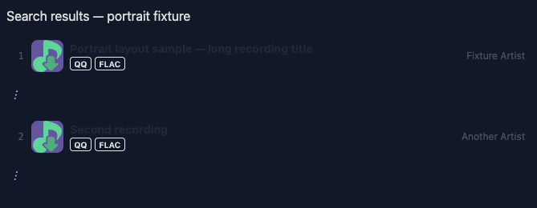
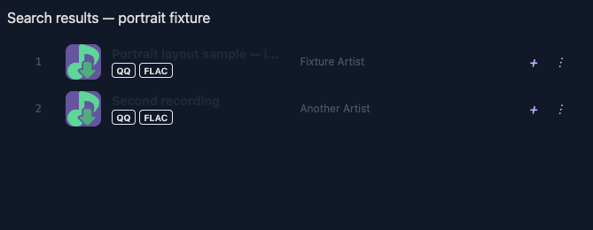

# Source-card and player-menu follow-up

## Scope

```text
Player UI
├── Source management/settings → shared stacked cards
├── Search/rankings → visible Add chooser → queue or playlist
└── Queue drawer → outside dismissal, preserved Escape/focus behavior
```

Source cards wrap long names/notices and keep actions below source information.
Source permissions, batch selection, disabled-platform indicators, drag order,
and escaped metadata/error text are retained. Search and rankings share a
keyboard-operable Add chooser and retain the captured recording when the view
changes. Outside queue dismissal does not steal focus from the clicked control,
change the queue or start playback.

## Duo portrait regression

The compact three-cell search grid must end at 639px: `sm:flex` reveals a
separate artist cell at 640px. Extending the compact grid through 767px places
four visible cells in three columns, moving the action controls to a second row.

PR #531 already contains the corrected 639px cutoff from its earlier review.
This follow-up documents that boundary and adds tests against the actual
generated artist visibility breakpoint, preventing the faulty 767px variant
from returning.

An isolated fixture using the real renderer and CSS reproduced the reported
669px portrait problem. Only synthetic song data is used in these images:

| Before: 767px cutoff | After: 639px cutoff |
| --- | --- |
|  |  |

The Chromium fixture row shrank from 100px to 52px at 669px. The controls align
with the title and there is no horizontal overflow at 382, 594, 639, 640, 669,
767, 768, 951 and 1440px. Fixture results are not physical iPhone/Safari proof.

## Verification

- Node 22.23.4, fresh lockfile install: **400 JavaScript + 226 TypeScript tests**
  pass, followed by the production TypeScript build.
- The 57 source-card/menu/drawer regressions pass. Applying these tests to
  unmodified upstream `dev` produced 38 failures before the fixes.
- Both breakpoint regressions fail against the faulty 767px layout and pass
  with the 639px boundary.
- Changed JavaScript syntax and whitespace/diff checks pass.
- The service-worker cache version advances so cached UI assets refresh.

This follow-up does not modify backend source, account settings, provider
scripts, MediaSession behavior or deployment configuration. Reverting it is a
two-way UI change; there are no data migrations.
